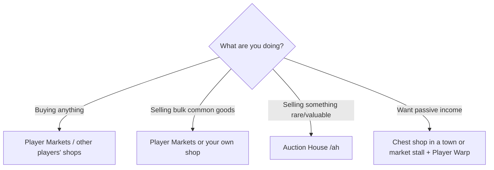

# Shops & Markets

TownifyMC has a **fully player-driven economy** — everything is bought and sold **by players**, which means real supply and demand, prices that move, and genuine opportunities to profit if you pay attention. Here's how each marketplace works and when to use it.

## Player markets

**Player markets** are the heart of the economy: chest shops run by players, all searchable from one menu. There is **no admin shop**. Every item for sale was stocked by a player.

```
/market         # browse every player shop (also /tm, /shops)
/market browse  # search the shop browser
```

Because every listing is set by a player, prices vary. Shop around, compare sellers, and you'll often find a bargain (or a gap you can undercut and profit from).

!!! tip "Selling here is your main income from goods"
    **Player markets and the [auction house](#the-auction-house) are how you turn gathered resources into money.** Keep an eye on what's in demand and price to move volume.

## Setting up your own chest shop

Want **passive income**? Run a chest shop so players can buy from (or sell to) you while you're offline.

1. **Place a container** you're allowed to build in: a **chest, trapped chest, barrel, or copper chest** on your own [town plot](../towns/towns.md) or a [rented market stall](#rent-a-market-stall).
2. **Hold the item** you want to trade and **shift-click the container**. Shift-click again to confirm.
3. **Type the price in chat.** Start the price with **`B`** to make a **buy** shop (players sell *to* you) instead of a sell shop. Shift-clicking the shop instead of typing uses the recommended price.
4. **Stock it** by putting items in the container. Shops can both buy and sell the same item.

```
/market myshops     # manage your shops and collect sales money
/market claim       # collect items from completed orders
/market offers      # see counter-offers from buyers
```

!!! info "Buy orders & counter-offers"
    Buyers can send you a **counter-offer** on a listing, and players can post **buy orders** that others fill. You'll get a chat notification either way. Check `/market offers`, and pick up anything owed with `/market claim`.

!!! tip "What sells well"
    - **Building blocks** in bulk (always in demand for big builds)
    - **Food** (everyone needs to eat)
    - **Enchanted gear and books**
    - **Rare drops and event items**
    - **Spawners** and farm products

Price competitively: watch your neighbors' prices and undercut where it makes sense. A well-stocked, fairly priced shop in a busy spot is good passive money, and a reliable supplier gets repeat customers.

## Rent a market stall

No town, or want a shop in the busiest spot on the server? Rent a **stall in the market district**.

```
/warp market
```

| Stall | Rent | Rent period |
|-------|------|-------------|
| **Shop** (40 stalls) | <span class="chip money">$100</span> per day | Extend 1 day at a time, up to **7 days** ahead |
| **Corner shop** (8 stalls) | <span class="chip money">$500</span> per day | Extend 1 day at a time, up to **7 days** ahead |

- Click a stall's **sign** to rent it, and click again to extend.
- If your rent runs out, the stall **resets** to empty, so keep it paid up and don't leave valuables in it.
- Inactive renters can lose their stall.

### Get more foot traffic with Player Warps

TownifyMC has **player warps**, which let you create a public warp point others can teleport to — perfect for driving customers to your shop.

```
/pwarp          # browse player warps
/pwarp create <name>    # create a warp (needs a free warp slot)
```

The number of player warps you can own scales with your [rank](../progression/ranks.md) (your first at **Count (#20)**, a second at **Jarl (#21)**, up to **5 at Royal (#25)**), or you can buy slots early from **`/upgrades`**, starting at $50,000 (see [Gem Store & Upgrades](../perks/store.md#player-warp-slots)). A warp named for your shop ("MegaBuild Blocks") pulls in buyers from across the map.

## The auction house

For **rare, high-value, one-off items**, use the auction house — list something and let the whole server bid or buy it.

```
/ah             # open the auction house
/ah sell <price>     # list the item in your hand
```

- Best for items a fixed-price listing would **undervalue** — rare gear, special drops, event items.
- The whole server sees your listing, so you get true market value.
- Check `/ah` regularly for deals — other players list valuable things too, and bargains go fast.

## Which should I use?



| Situation | Use |
|-----------|-----|
| Buying items | **Player markets** / other players' shops |
| Selling lots of common items | **Player markets** / your own shop |
| Selling a rare, valuable item | **Auction house** (`/ah`) |
| Building passive income | **Your own chest shop** (town plot or rented stall) + a **player warp** |

!!! note "It's all players"
    Since the economy is entirely player-run, **the best prices come from paying attention** — to what's in demand, what's overpriced, and where there's no seller yet. That gap is your opportunity.

---

**Next:** [Fishing →](fishing.md)
